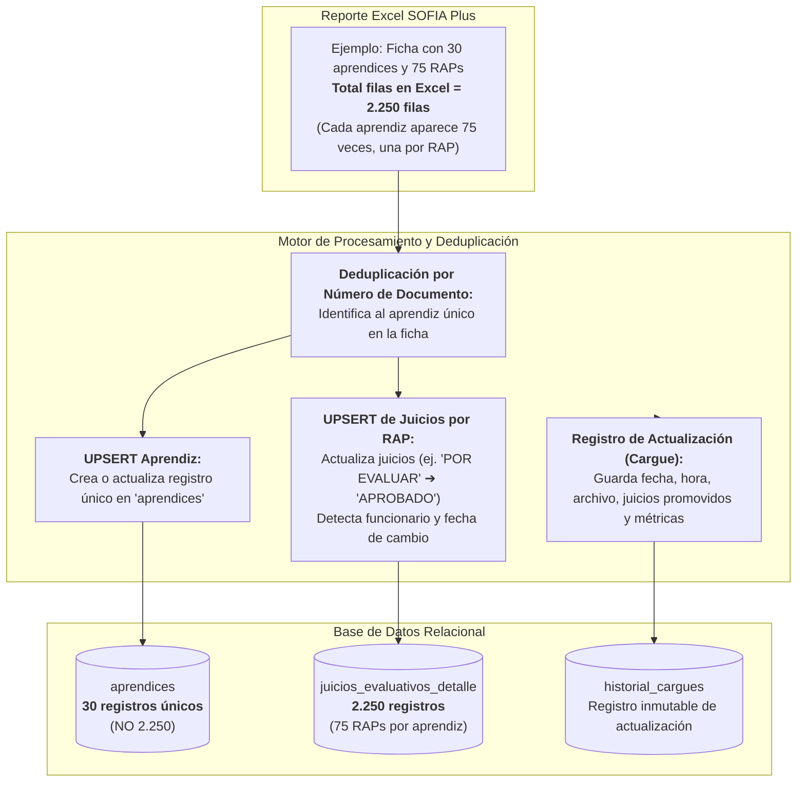

# HU-008: Sección y Carga de Reportes de Juicios Evaluativos (Formato Oficial SENA Excel)

## 1. Historia de Usuario

**Como** instructor del SENA,  
**quiero** adjuntar y procesar archivos de reporte de juicios de evaluación en formato Excel (`.xls` / `.xlsx`) exportados desde SOFIA Plus / Zajuna,  
**para** registrar de forma acumulativa y auditable el avance de los aprendices, garantizando que cada aprendiz se registre una única vez en la ficha a pesar de que el archivo contenga una fila por cada Resultado de Aprendizaje (ej. 75 RAPs en ADSO), manteniendo el registro histórico de cada cargue y la actualización de sus juicios.

---

## 2. Reglas de Negocio Críticas: Deduplicación y Trazabilidad



### RN-01: Cardinalidad 1 a N (1 Aprendiz ➔ N RAPs)
* En los programas técnicos y tecnológicos del SENA (como ADSO con ~75 RAPs), el archivo institucional exporta **una fila por cada combinación de Aprendiz + RAP**.
* **Regla estricta:** Un aprendiz debe existir **una sola vez** en la entidad/tabla `aprendices` para la ficha dada.
* Bajo ninguna circunstancia deben crearse 75 registros del mismo aprendiz. Los 75 registros corresponden a la tabla de detalle `juicios_evaluativos_detalle` asociada a su identificador único.

### RN-02: Lógica de Actualización Acumulativa (UPSERT)
* Cuando el instructor carga un nuevo reporte de corte o período posterior:
  1. Si el aprendiz ya existe en la ficha (coincidencia por `Número de Documento`), se actualizan sus datos personales y su estado formativo (ej. si pasó de `EN FORMACION` a `CANCELADO`).
  2. Si el juicio del RAP para ese aprendiz ya existía y cambió (ejemplo: pasó de `POR EVALUAR` a `APROBADO`):
     - Se actualiza el estado del juicio al nuevo valor.
     - Se actualiza la `Fecha y Hora del Juicio Evaluativo`.
     - Se asienta el `Funcionario que registró el juicio evaluativo`.
  3. Si es un nuevo RAP que no estaba registrado, se inserta.

### RN-03: Registro Histórico de Cada Cargue de Actualización
* Cada evento de subida genera un registro inmutable en `historial_cargues`:
  - **Número consecutivo de cargue** (Cargue #1, Cargue #2, etc.).
  - **Nombre del archivo y hash SHA-256.**
  - **Fecha del reporte en SOFIA y fecha/hora exacta del cargue.**
  - **Métricas diferenciales:**
    - Cuántos aprendices fueron actualizados.
    - Cuántos juicios pasaron de `POR EVALUAR` a `APROBADO`.
    - Total de juicios aprobados y pendientes acumulados.
    - Observaciones del cargue.

---

## 3. Criterios de Aceptación Específicos

### CA-01: Deduplicación Automática en Memoria y Base de Datos
- Al parsear el archivo Excel, el sistema agrupa los registros por `Número de Documento`.
- La lista de aprendices muestra únicamente una fila por aprendiz con:
  - Tipo y Número de Documento.
  - Nombre completo.
  - Estado académico.
  - **Barra de Progreso y Métrica:** RAPs aprobados sobre el total de RAPs del programa (ej. `45 / 75 RAPs (60%)`).
- Al hacer clic en un aprendiz, se desglosa el detalle de sus 75 RAPs clasificados por competencia.

### CA-02: Registro de Actualización y Log de Cambios
- Al procesar el reporte, el sistema compara los juicios nuevos contra los juicios almacenados previamente:
  - Muestra un reporte diferencial:
    > *"Se actualizaron 12 juicios a estado APROBADO para 8 aprendices."*
- Se añade una tarjeta al historial de cargues con las métricas del corte.

### CA-03: Almacenamiento Seguro del Archivo Original
- El archivo binario original se guarda con su hash SHA-256 para permitir descargas o revisiones de auditoría en cualquier momento.

---

## 4. Modelo de Base de Datos PostgreSQL

```sql
-- 1. Fichas
CREATE TABLE IF NOT EXISTS fichas (
    id SERIAL PRIMARY KEY,
    numero_ficha VARCHAR(20) NOT NULL UNIQUE,
    programa_nombre VARCHAR(255) NOT NULL,
    programa_codigo VARCHAR(50) DEFAULT '228118',
    jornada VARCHAR(50) NOT NULL,
    fecha_inicio DATE NOT NULL,
    fecha_fin DATE,
    estado VARCHAR(30) DEFAULT 'EN EJECUCION'
);

-- 2. Aprendices Únicos por Ficha (1 solo registro por persona)
CREATE TABLE IF NOT EXISTS aprendices (
    id SERIAL PRIMARY KEY,
    ficha_id INT NOT NULL REFERENCES fichas(id) ON DELETE CASCADE,
    tipo_documento VARCHAR(10) NOT NULL,
    numero_documento VARCHAR(25) NOT NULL,
    nombre VARCHAR(150) NOT NULL,
    apellidos VARCHAR(150) NOT NULL,
    estado_sena VARCHAR(50) DEFAULT 'EN FORMACION',
    creado_en TIMESTAMP DEFAULT CURRENT_TIMESTAMP,
    actualizado_en TIMESTAMP DEFAULT CURRENT_TIMESTAMP,
    CONSTRAINT uq_aprendiz_ficha UNIQUE (numero_documento, ficha_id)
);

-- 3. Historial de Cargues y Actualizaciones (Registro de cada archivo)
CREATE TABLE IF NOT EXISTS historial_cargues (
    id SERIAL PRIMARY KEY,
    ficha_id INT NOT NULL REFERENCES fichas(id) ON DELETE CASCADE,
    consecutivo_cargue INT NOT NULL,
    nombre_archivo VARCHAR(255) NOT NULL,
    hash_sha256 VARCHAR(64) NOT NULL,
    fecha_reporte_sena DATE,
    fecha_cargue TIMESTAMP DEFAULT CURRENT_TIMESTAMP,
    total_filas_procesadas INT NOT NULL,
    aprendices_afectados INT NOT NULL,
    juicios_nuevos_aprobados INT DEFAULT 0,
    juicios_pendientes INT DEFAULT 0,
    subido_por VARCHAR(150) DEFAULT 'Carlos Julio Cadena'
);

-- 4. Detalle de Juicios por RAP y Aprendiz (1 registro por Aprendiz + RAP)
CREATE TABLE IF NOT EXISTS juicios_evaluativos_detalle (
    id SERIAL PRIMARY KEY,
    ficha_id INT NOT NULL REFERENCES fichas(id) ON DELETE CASCADE,
    aprendiz_id INT NOT NULL REFERENCES aprendices(id) ON DELETE CASCADE,
    cargue_id INT REFERENCES historial_cargues(id) ON DELETE SET NULL,
    competencia_denominacion TEXT NOT NULL,
    resultado_aprendizaje TEXT NOT NULL,
    juicio_evaluacion VARCHAR(50) NOT NULL, -- 'APROBADO', 'POR EVALUAR', 'NO APROBADO'
    fecha_hora_juicio TIMESTAMP,
    funcionario_registro VARCHAR(255),
    actualizado_en TIMESTAMP DEFAULT CURRENT_TIMESTAMP,
    CONSTRAINT uq_juicio_aprendiz_rap UNIQUE (aprendiz_id, resultado_aprendizaje)
);

CREATE INDEX idx_juicios_aprendiz ON juicios_evaluativos_detalle(aprendiz_id);
CREATE INDEX idx_juicios_rap ON juicios_evaluativos_detalle(resultado_aprendizaje);
CREATE INDEX idx_juicios_estado ON juicios_evaluativos_detalle(juicio_evaluacion);
```
