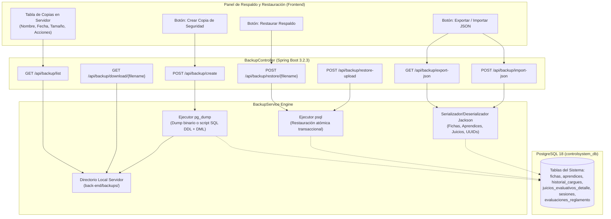

# HU-010: Copias de Seguridad, Respaldo y Restauración de Base de Datos

## 1. Historia de Usuario

**Como** instructor del SENA y administrador del sistema de control,  
**quiero** generar copias de seguridad completas de la base de datos (en formato SQL nativo PostgreSQL y JSON portable), descargar los respaldos, consultar el historial de copias almacenadas en el servidor y restaurar la información en cualquier momento,  
**para** salvaguardar la integridad de los datos académicos, juicios evaluativos, aprendices y evidencias ante contingencias, asegurando la continuidad del seguimiento formativo y el cumplimiento de las políticas de custodia institucional.

---

## 2. Diagrama de Arquitectura y Flujo de Operación

---

## 3. Reglas de Negocio

### RN-01: Dualidad de Formatos de Respaldo
1. **Respaldo SQL Nativo (`.sql`):** Generado mediante `pg_dump` con esquema relacional completo, llaves primarias UUID, secuencias, índices y sentencias `INSERT` transaccionales. Es el estándar recomendado para respaldos completos de producción en PostgreSQL 18.
2. **Respaldo Portátil JSON (`.json`):** Exportación estructurada de todas las entidades del dominio con relaciones jerárquicas preservadas. Permite inspección visual, migración entre distintos motores y restauración independiente de plataforma.

### RN-02: Nomenclatura Estandarizada y Trazabilidad
Los archivos de respaldo generados en el servidor siguen la convención cronológica:
`backup_controlsystem_YYYYMMDD_HHmmss.sql`
Garantiza unicidad temporal, orden cronológico natural en listados y trazabilidad del momento exacto del volcado.

### RN-03: Integridad y Transaccionalidad en Restauración
- Antes de ejecutar una restauración, el sistema emite una advertencia de confirmación explícita al usuario indicando que los datos actuales serán reemplazados por los del respaldo.
- La restauración mediante `psql` o importador JSON se ejecuta con validación de esquema, asegurando la no duplicidad de UUIDs y consistencia de llaves foráneas (`fichas` ➔ `aprendices` ➔ `juicios_evaluativos_detalle`).

### RN-04: Gestión de Almacenamiento Local
- El servidor mantiene las copias en el directorio seguro `back-end/backups/`.
- El instructor puede descargar cualquier respaldo a su máquina cliente mediante el endpoint `/download/{filename}`.
- Opcionalmente, el instructor puede subir un archivo `.sql` externo para restaurar una copia guardada en medios externos (USB, Drive).

---

## 4. Criterios de Aceptación

### CA-01: Creación Exitosa de Respaldo
- **Dado** que el instructor hace clic en "Crear Copia de Seguridad",
- **Cuando** el backend ejecuta `pg_dump` contra `controlsystem_db`,
- **Entonces** se crea un archivo `.sql` en el directorio de respaldos,
- **Y** la interfaz actualiza inmediatamente la tabla de copias disponibles mostrando nombre, fecha de creación, tamaño en KB/MB y estado exitoso.

### CA-02: Descarga de Archivo de Copia
- **Dado** que existe al menos una copia de seguridad en el servidor,
- **Cuando** el instructor pulsa el botón de descarga en la fila correspondiente,
- **Entonces** el navegador descarga el archivo `.sql` con tipo MIME `application/octet-stream` y el nombre original.

### CA-03: Restauración Controlada de Base de Datos
- **Dado** que se selecciona una copia del listado o se adjunta un archivo `.sql` para restaurar,
- **Cuando** el instructor confirma el diálogo modal de advertencia,
- **Entonces** el backend aplica el script contra la base de datos,
- **Y** notifica el número de tablas y registros restaurados exitosamente, refrescando los datos en pantalla.

### CA-04: Exportación e Importación Portátil en JSON
- **Dado** que el instructor requiere un respaldo liviano e independiente de `pg_dump`,
- **Cuando** pulsa "Exportar JSON",
- **Entonces** recibe un archivo `backup_controlsystem_portable.json` con todos los aprendices, fichas y juicios con sus respectivos UUIDs.

---

## 5. Especificación de Endpoints REST

| Método | Endpoint | Descripción | Parámetros / Body |
|---|---|---|---|
| `POST` | `/api/backup/create` | Ejecuta `pg_dump` y almacena respaldo `.sql` | Ninguno |
| `GET` | `/api/backup/list` | Lista las copias de seguridad existentes | Retorna `List<BackupFileDTO>` |
| `GET` | `/api/backup/download/{filename}` | Descarga un archivo de respaldo específico | Variable de ruta `filename` |
| `POST` | `/api/backup/restore/{filename}` | Restaura el sistema desde un archivo del servidor | Variable de ruta `filename` |
| `POST` | `/api/backup/restore-upload` | Sube un archivo `.sql` y lo restaura | `multipart/form-data` (`file`) |
| `GET` | `/api/backup/export-json` | Genera volcado portátil JSON de todas las tablas | Retorna JSON estructurado |
| `POST` | `/api/backup/import-json` | Restaura el sistema a partir de volcado JSON | Body JSON (`FullDatabaseDTO`) |
