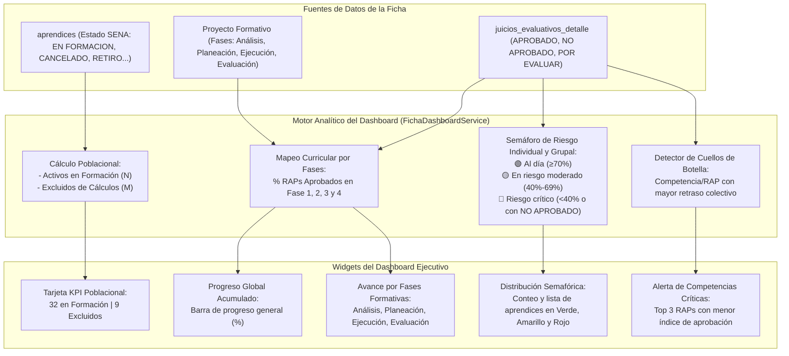

# HU-011: Dashboard Ejecutivo y Tablero de Control de Progreso por Ficha

## 1. Historia de Usuario

**Como** instructor líder o de área del SENA,  
**quiero** visualizar un tablero de control ejecutivo con indicadores consolidados de la ficha (total de aprendices en formación, aprendices excluidos, avance por fases del proyecto formativo, semáforo de riesgo académico y detección de competencias críticas en cuello de botella),  
**para** monitorear oportunamente el estado real de avance de la cohorte, tomar decisiones pedagógicas preventivas, focalizar planes de mejoramiento y sustentar comités de evaluación y seguimiento con cifras exactas.

---

## 2. Diagrama Conceptual del Tablero de Progreso

---

## 3. Reglas de Negocio

### RN-01: Diferenciación de Aprendices Activos vs Excluidos
- Los aprendices con estado `EN FORMACION` o `CONDICIONADO` son considerados **Activos en Formación** e ingresan en el cálculo estadístico del porcentaje global de la ficha.
- Los aprendices con estado `CANCELADO`, `RETIRO VOLUNTARIO`, `TRASLADO`, `APLAZADO` o `DESERCION` se clasifican como **Excluidos de cálculos**.
- La tarjeta de cabecera debe exhibir claramente:  
  `Aprendices de la Ficha (Total Únicos) | Total en Formación: X | Excluidos de cálculos: Y`.

### RN-02: Avance por Fases del Proyecto Formativo
Cuando la ficha cuenta con su proyecto formativo cargado (Formato GFPI-F-016), los RAPs evaluados se asocian a su fase metodológica:
1. **Fase I - Análisis:** RAPs de fundamentación, requerimientos e inducción.
2. **Fase II - Planeación:** RAPs de arquitectura, diseño lógico y modelado.
3. **Fase III - Ejecución:** RAPs de codificación, pruebas unitarias y construcción de software.
4. **Fase IV - Evaluación:** RAPs de despliegue, entrega a producción e informe de impacto.
Cada fase muestra su porcentaje de cumplimiento respecto a los RAPs asignados.

### RN-03: Criterios del Semáforo de Riesgo Académico
Para cada aprendiz activo:
- 🟢 **Verde (Normal / Al Día):** Progreso de RAPs aprobados $\ge 70\%$ respecto a lo esperado y 0 juicios `NO APROBADO`.
- 🟡 **Amarillo (Riesgo Moderado):** Progreso entre $40\%$ y $69\%$ de RAPs aprobados y 0 juicios `NO APROBADO`.
- 🔴 **Rojo (Riesgo Crítico):** Progreso $< 40\%$ O existencia de 1 o más juicios en estado `NO APROBADO` (motivo de citación inmediata a Comité de Evaluación según el Reglamento del Aprendiz).

### RN-04: Detección de Competencias en Cuello de Botella
El sistema calcula la tasa de reprobación y de pendientes por competencia técnica o transversal, identificando las asignaturas donde el grupo experimenta mayor rezago para orientar refuerzos pedagógicos o co-tutorías.

---

## 4. Criterios de Aceptación

### CA-01: Visualización Inmediata al Abrir la Ficha
- **Dado** que el instructor ingresa a los detalles de una ficha,
- **Cuando** carga la vista principal,
- **Entonces** se despliegan en la parte superior las tarjetas KPI con el total de aprendices activos vs excluidos y el porcentaje de avance consolidado de la ficha.

### CA-02: Filtrado Interactivo del Semáforo
- **Dado** el widget de distribución de riesgo académico,
- **Cuando** el instructor hace clic sobre el segmento "Rojo (Crítico)",
- **Entonces** la tabla de aprendices se filtra automáticamente para mostrar exclusivamente los aprendices en riesgo crítico o con juicios reprobados, facilitando la evaluación normativa inmediata.

### CA-03: Auditoría y Resumen de Reprobados
- **Dado** que un aprendiz tiene RAPs con juicio `NO APROBADO`,
- **Cuando** se visualiza la tabla o el modal individual del aprendiz,
- **Entonces** se resalta en rojo la cantidad exacta de RAPs reprobados y el botón directo para "Evaluar según Reglamento".

---

## 5. Componentes de Interfaz Involucrados

| Componente | Archivo | Responsabilidad |
|---|---|---|
| `DashboardStats.jsx` | `front-end/src/components/DashboardStats.jsx` | Tarjetas de métricas, gráficos de dona/barras y KPIs poblacionales |
| `LearnerCard.jsx` | `front-end/src/components/LearnerCard.jsx` | Tarjeta individual con progreso porcentual y estado de RAPs |
| `FichaDetail.jsx` | `front-end/src/components/FichaDetail.jsx` | Orquestador de vistas: Tablero, Aprendices, Cargues, Proyecto |
| `AprendicesTable.jsx` | `front-end/src/components/AprendicesTable.jsx` | Tabla consolidada con ordenamiento y filtros por estado |

