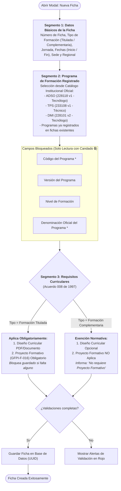

# HU-012: Segmentación Normativa para Creación de Fichas y Validación Curricular

## 1. Historia de Usuario

**Como** instructor o coordinador académico del SENA,  
**quiero** disponer de un asistente modal segmentado en 3 pasos normativos para la creación y configuración de fichas, con selección exclusiva de programas de formación registrados en catálogo (mostrando sus atributos en modo solo lectura) y aplicación estricta de los requisitos de diseño curricular y proyecto formativo según el tipo de formación (Titulada vs. Complementaria, conforme al Acuerdo 008 de 1997),  
**para** garantizar el rigor normativo institucional, evitar la captura manual errónea de códigos o denominaciones de programa y asegurar que toda ficha titulada cuente con su sustento pedagógico formal antes de iniciar la gestión de aprendices y juicios evaluativos.

---

## 2. Diagrama del Asistente Segmentado y Reglas Curriculares

---

## 3. Reglas de Negocio

### RN-01: Selección Estricta de Programas Registrados (Segmento 2)
- El selector de programas únicamente lista ofertas curriculares registradas en el catálogo institucional oficial (`PROGRAMAS_CATALOGO`) y aquellas que ya se encuentren registradas en la base de datos de fichas.
- No se permite el tipeo libre de denominaciones de programa ni códigos en este paso.
- Al seleccionar el programa del menú desplegable, los cuatro atributos curriculares se completan automáticamente y se muestran en modo **Solo Lectura (`readOnly`)**, con fondo contrastado (`#f1f5f9`), texto oscuro de alta legibilidad (`#0f172a`) e icono de candado de seguridad:
  1. **Código del Programa:** (ej. `228118`).
  2. **Versión del Programa:** (ej. `1`).
  3. **Nivel de Formación:** (ej. `Tecnólogo`, `Técnico Laboral`, `Operario`).
  4. **Denominación Oficial:** (ej. `ANALISIS Y DESARROLLO DE SOFTWARE`).

### RN-02: Aplicación del Marco Normativo Curricular (Acuerdo 008 de 1997)
Conforme a la reglamentación del Estatuto de la Formación Profesional Integral del SENA (Acuerdo 008 de 1997):
- **Formación Titulada (Técnico, Tecnólogo, Especialización Técnica/Tecnológica):**
  - Requiere obligatoriamente la vinculación de la estructura curricular y el **Proyecto Formativo Institucional** (formato GFPI-F-016), en el cual se articulan las 4 Fases formativas (Análisis, Planeación, Ejecución y Evaluación) con las competencias y Resultados de Aprendizaje (RAPs).
  - El sistema no permite completar el registro de la ficha si no se adjunta o selecciona el proyecto formativo correspondiente.
- **Formación Complementaria (Cursos cortos, actualización ocupacional):**
  - Orientada a cualificaciones rápidas o módulos específicos.
  - **No aplica** la exigencia de Proyecto Formativo; el sistema deshabilita dicho requisito y muestra una insignia informativa institucional indicando la exención.

### RN-03: Navegación Segmentada e Integridad de Datos
- El modal implementa una barra de pasos (1. Datos Básicos ➔ 2. Programa de Formación ➔ 3. Requisitos Curriculares) con botones de avance "Siguiente" y retroceso "Anterior".
- El botón final "Guardar Ficha" solo se activa cuando se han superado satisfactoriamente los criterios de validación de los 3 segmentos.

---

## 4. Criterios de Aceptación

### CA-01: Despliegue de Programas Registrados
- **Dado** que el usuario abre el modal y avanza al Segmento 2,
- **Cuando** despliega el campo "Seleccionar Programa Registrado",
- **Entonces** observa únicamente los programas disponibles en catálogo y fichas registradas, sin opciones ficticias ni campos editables a mano.

### CA-02: Bloqueo de Campos Curriculares Oficiales
- **Dado** que el usuario selecciona el programa `228118 - ANALISIS Y DESARROLLO DE SOFTWARE`,
- **Cuando** se rellenan los campos de Código, Versión, Nivel y Denominación,
- **Entonces** todos los 4 campos quedan en modo solo lectura, impidiendo su edición manual o alteración accidental.

### CA-03: Exigencia de Proyecto Formativo en Titulada
- **Dado** que en el Segmento 1 se eligió tipo de formación "Titulada",
- **Cuando** el usuario llega al Segmento 3,
- **Entonces** el campo de Proyecto Formativo se marca como obligatorio con asterisco rojo, y el sistema impide el guardado si no se ha cargado el archivo o seleccionado una plantilla válida.

### CA-04: Exención en Formación Complementaria
- **Dado** que en el Segmento 1 se seleccionó "Formación Complementaria",
- **Cuando** el usuario avanza al Segmento 3,
- **Entonces** el campo de Proyecto Formativo queda oculto o marcado como "No Aplica según normativa Acuerdo 008 de 1997", permitiendo guardar la ficha directamente.

---

## 5. Implementación en Código

- **Componente Modal:** `front-end/src/components/FichaModal.jsx`
- **Catálogo Institucional:** Constante `PROGRAMAS_CATALOGO` y unificación con `fichas.map(f => f.programa)`.
- **Servicio de Persistencia:** Invocación a `fichaService.create()` con payload estructurado y generación de identificadores `UUIDv4`.

