# HU-013: Reorganización y Ordenamiento Interactivo por Columnas en Todas las Tablas del Sistema

## 1. Historia de Usuario

**Como** instructor del SENA,  
**quiero** hacer clic sobre cualquier encabezado de columna en todas las tablas del sistema para reorganizar y ordenar sus registros en orden ascendente y descendente (alfabético, numérico, fechas o porcentajes de avance),  
**para** analizar con agilidad grandes volúmenes de datos, priorizar rápidamente aprendices con juicios reprobados o menor progreso, auditar citaciones a comité, consultar sesiones cronológicas y localizar información crítica sin necesidad de exportar a hojas de cálculo externas.

---

## 2. Cobertura de Vistas Tabulares del Sistema

```mermaid
flowchart LR
    subgraph TablasSistema["7 Vistas Tabulares con Ordenamiento Interactivo (▲ / ▼)"]
        T1["1. Tabla de Fichas de Formación<br/>(Número, Programa, Jornada, Fecha, Estado)"]
        T2["2. Tabla de Aprendices de la Ficha<br/>(Tipo, Documento, Nombres, Estado, Progreso, Reprobados)"]
        T3["3. Tabla de Auditoría y Citaciones a Comité<br/>(Fecha, Documento, Aprendiz, Motivo, Gravedad, Comité)"]
        T4["4. Tabla de Juicios por Aprendiz<br/>(Competencia, RAP, Juicio, Fecha, Funcionario)"]
        T5["5. Tabla de Sesiones de Asistencia<br/>(Fecha, Tema, Horario, Asistentes, Acciones)"]
        T6["6. Tabla de Trabajos y Evidencias<br/>(Título, Fecha Límite, Entregas, Estado)"]
        T7["7. Tabla de Historial de Cargues<br/>(Consecutivo, Archivo, Fecha Reporte, Juicios, Usuario)"]
    end

    subgraph SortingEngine["Motor de Ordenamiento (useTableSort / sortUtils)"]
        CompStr["Comparador Alfanumérico<br/>localeCompare con soporte de tildes y ñ"]
        CompNum["Comparador Numérico / Documentos<br/>Parseo de enteros, decimales y porcentajes"]
        CompDate["Comparador Cronológico<br/>Parseo ISO 8601 y formatos SENA DD/MM/YYYY"]
    end

    TablasSistema --> SortingEngine
```

---

## 3. Reglas de Negocio

### RN-01: Comportamiento de Tres Estados (Toggle Tri-Estado)
1. **Primer clic en cabecera:** Ordena la columna de forma **Ascendente** (A ➔ Z, menor a mayor, más antiguo a más reciente). Se muestra el indicador visual `▲`.
2. **Segundo clic en cabecera:** Invierte el orden a **Descendente** (Z ➔ A, mayor a menor, más reciente a más antiguo). Se muestra el indicador visual `▼`.
3. **Clic en una cabecera distinta:** Se transfiere el foco de ordenamiento a la nueva columna seleccionada en orden ascendente, restableciendo las demás.

### RN-02: Normalización y Tipos de Datos en Comparación
El motor de ordenamiento detecta o clasifica el tipo de dato de la columna para evitar errores típicos de ordenamiento léxico:
- **Cadenas de texto y nombres:** Uso de `String.prototype.localeCompare('es', { sensitivity: 'base', numeric: true })` para garantizar el orden correcto de nombres en español (respetando tildes, mayúsculas y la letra `Ñ`).
- **Números de documento:** Tratados numéricamente para que `1080...` preceda a números de 10 dígitos y no se mezclen incorrectamente con cédulas de 7 u 8 dígitos.
- **Porcentajes de progreso:** Ordenamiento basado en el valor float subyacente (ej. `75.7%` > `24.1%`), no en la cadena de caracteres.
- **Fechas y horas:** Conversión a milisegundos (`timestamp`) asegurando que fechas como `16/12/2025` se ubiquen cronológicamente respecto a fechas de otros meses o años.

### RN-03: Indicación Visual y Accesibilidad
- Las cabeceras con soporte de ordenamiento muestran un cursor de tipo `pointer` y un efecto `hover` distintivo.
- La columna activamente ordenada resalta su fondo o texto con un color temático distintivo (`#059669` / verde SENA o azul institucional) e incluye el glifo flecha indicativo (`▲` / `▼`).

---

## 4. Criterios de Aceptación

### CA-01: Ordenamiento en Tabla de Aprendices (HU-004 / HU-008)
- **Dado** el listado de aprendices de una cohorte (ej. 41 aprendices),
- **Cuando** el instructor hace clic en la cabecera **"Reprobados"** en orden descendente,
- **Entonces** los aprendices con juicios `NO APROBADO` (ej. 4 reprobados) se ubican en las primeras posiciones de la tabla de forma instantánea.

### CA-02: Ordenamiento por Progreso de RAPs Aprobados
- **Dado** el listado de aprendices,
- **Cuando** el usuario pulsa en la cabecera **"Progreso de RAPs Aprobados"**,
- **Entonces** la tabla se reordena del menor al mayor porcentaje (o viceversa), permitiendo identificar al instante a los aprendices más rezagados.

### CA-03: Ordenamiento en Auditoría de Citaciones a Comité (HU-005)
- **Dado** el historial de evaluaciones normativas según el reglamento,
- **Cuando** se pulsa la columna **"Gravedad"** o **"Fecha"**,
- **Entonces** las faltas `GRAVÍSIMAS` o más recientes se agrupan prioritariamente para su revisión por parte del comité.

### CA-04: Persistencia Temporal del Estado
- El ordenamiento se mantiene mientras el instructor filtra o busca por texto (por ejemplo, buscar "Cabrera" mantendrá el orden seleccionado sobre el subconjunto filtrado).

---

## 5. Implementación en el Proyecto

- **Hook y Utilidades:** `front-end/src/hooks/useTableSort.js` / funciones de ordenamiento `sortRecords(data, key, direction)`.
- **Componentes Actualizados:**
  1. `AprendicesTable.jsx` (Tabla de aprendices y reprobados).
  2. `FichasList.jsx` / `FichaCard.jsx` (Listado y filtros de fichas).
  3. `ReglamentoModal.jsx` / `ComiteAuditTable.jsx` (Tabla de auditoría de citaciones y evaluaciones).
  4. `LearnerModal.jsx` (Tabla de detalle de competencias y 75 RAPs).
  5. `AttendanceList.jsx` (Tabla de sesiones de asistencia).
  6. `WorksList.jsx` (Tabla de trabajos y evidencias).
  7. `HistorialCarguesTable.jsx` (Tabla de auditoría de archivos SOFIA cargados).

