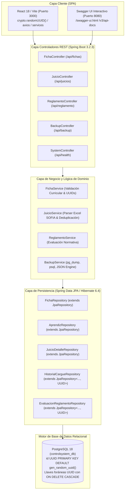

# HU-014: Arquitectura Backend Spring Boot 3.2, Persistencia PostgreSQL 18 con Identificadores UUIDv4 y Documentación OpenAPI/Swagger

## 1. Historia de Usuario

**Como** desarrollador y arquitecto de software del sistema,  
**quiero** implementar una arquitectura backend moderna y robusta basada en Spring Boot 3.2.3 (Java 17) y PostgreSQL 18, con identificadores universales únicos (UUIDv4) en todas las tablas y entidades del dominio, herramientas de productividad de desarrollo (Spring Boot DevTools), documentación viva e interactiva mediante OpenAPI 3 / Swagger UI (`/swagger-ui.html`), y eliminación total de sembradores con datos ficticios (`DataInitializer`),  
**para** garantizar un diseño desacoplado de alta escalabilidad, seguridad frente a ataques de enumeración de IDs secuenciales, contratos de API REST claros y verificables, y protección estricta de la base de datos sin inyección de datos simulados.

---

## 2. Diagrama de Arquitectura de Capas Backend



---

## 3. Principios y Reglas de Diseño Técnico

### RN-01: Identificadores Universales Únicos (UUIDv4)
1. **En Base de Datos (PostgreSQL 18):**  
   Todas las tablas maestras y de detalle definen su llave primaria como:
   `id UUID PRIMARY KEY DEFAULT gen_random_uuid()`
   Las llaves foráneas (`ficha_id`, `aprendiz_id`, `cargue_id`, etc.) son de tipo `UUID` con restricciones relacionales explícitas e índices de alta concurrencia.
2. **En Entidades JPA (Hibernate 6.4):**  
   Uso de la anotación estándar:
   ```java
   @Id
   @GeneratedValue(strategy = GenerationType.UUID)
   @Column(name = "id", updatable = false, nullable = false)
   private UUID id;
   ```
3. **En Frontend (JavaScript / React):**  
   Uso nativo de `crypto.randomUUID()` encapsulado en `front-end/src/utils/uuid.js` con validador de formato RFC 4122.
4. **Beneficios de Seguridad y Escalabilidad:**  
   - Previene ataques de referencia directa de objetos (IDOR) y enumeración secuencial de aprendices o fichas.
   - Permite la creación distribuida y concurrente de registros sin colisión de claves.

### RN-02: Documentación Viva OpenAPI 3 / Swagger UI
- Integración de `springdoc-openapi-starter-webmvc-ui` versión `2.3.0`.
- Documentación interactiva accesible en tiempo real en:
  `http://localhost:8080/swagger-ui.html`
- Exposición de especificación OpenAPI en formato JSON en:
  `http://localhost:8080/v3/api-docs`
- Cada controlador, DTO y parámetro se encuentra categorizado por tags semánticos (Fichas, Juicios Evaluativos, Reglamento, Backups, Diagnóstico).

### RN-03: Herramientas de Desarrollo (DevTools)
- Inclusión de `spring-boot-devtools` en `back-end/pom.xml` con alcance `runtime` y `optional=true`.
- Permite reinicio automático del contexto ante cambios en clases de servicio y controladores durante las sesiones de desarrollo, reduciendo los tiempos de ciclo sin afectar el empaquetado para despliegue final.

### RN-04: Cero Datos Simulados (No Mock Data Initializer)
- Eliminación intencional de cualquier componente `CommandLineRunner` o `DataInitializer` que cargue aprendices o fichas ficticias al iniciar el servidor.
- La base de datos opera exclusivamente con información institucional real suministrada o cargada por el instructor mediante los archivos oficiales de SOFIA Plus y las pantallas del sistema.

---

## 4. Matriz de Endpoints Documentados en Swagger

| Tag / Módulo | Método | Endpoint | Descripción | Identificadores |
|---|---|---|---|---|
| **Fichas** | `GET` | `/api/fichas` | Consulta de todas las fichas | UUID |
| **Fichas** | `GET` | `/api/fichas/{id}` | Consulta ficha por UUID o número | UUID / String |
| **Fichas** | `POST` | `/api/fichas` | Crea nueva ficha con validación curricular | UUID generado |
| **Fichas** | `PUT` | `/api/fichas/{id}` | Actualiza datos y proyecto de ficha | UUID |
| **Fichas** | `DELETE`| `/api/fichas/{id}` | Eliminación en cascada de ficha | UUID |
| **Juicios** | `POST` | `/api/juicios/cargue-excel/{fichaId}` | Carga y procesa archivo Excel SOFIA | UUID Ficha |
| **Juicios** | `GET` | `/api/juicios/ficha/{fichaId}/aprendices` | Aprendices únicos y métricas | UUID Ficha |
| **Juicios** | `GET` | `/api/juicios/aprendiz/{aprendizId}` | 75 RAPs y juicios por aprendiz | UUID Aprendiz |
| **Juicios** | `GET` | `/api/juicios/ficha/{fichaId}/historial` | Historial de cargues de archivo | UUID Ficha |
| **Reglamento**| `POST` | `/api/reglamento/evaluar` | Evalúa falta y genera citación | UUID Aprendiz |
| **Reglamento**| `GET` | `/api/reglamento/ficha/{fichaId}` | Evaluaciones y citaciones a comité | UUID Ficha |
| **Backups** | `POST` | `/api/backup/create` | Genera volcado `pg_dump` | Archivo SQL |
| **Backups** | `GET` | `/api/backup/list` | Lista respaldos en servidor | Listado |
| **Backups** | `POST` | `/api/backup/restore/{filename}` | Restaura BD desde archivo | Nombre de archivo |
| **Diagnóstico**| `GET`| `/api/health` | Estado del backend y BD | Objeto de salud |

---

## 5. Criterios de Aceptación y Verificación

### CA-01: Verificación de Swagger UI
- **Dado** que el backend Spring Boot está en ejecución en el puerto 8080,
- **Cuando** el usuario ingresa a `http://localhost:8080/swagger-ui.html` desde su navegador,
- **Entonces** se despliega la consola gráfica con todos los controladores agrupados, esquemas de DTOs y botón "Try it out" para probar peticiones en vivo.

### CA-02: Generación Consistente de UUIDs
- **Dado** que se realiza una petición `POST /api/fichas` para registrar una ficha,
- **Cuando** el backend responde exitosamente con código `200 OK`,
- **Entonces** la respuesta incluye un campo `id` con un valor UUID válido en formato `xxxxxxxx-xxxx-4xxx-yxxx-xxxxxxxxxxxx` tanto en la entidad `FichaEntity` como en la base de datos PostgreSQL.

### CA-03: Arranque Limpio Sin Datos Mock
- **Dado** que se inicia el servicio backend sobre una base de datos vacía,
- **Cuando** se consulta `GET /api/fichas`,
- **Entonces** la respuesta es una lista vacía `[]`, confirmando que ningún componente `DataInitializer` sembró datos ficticios en la base de datos.

