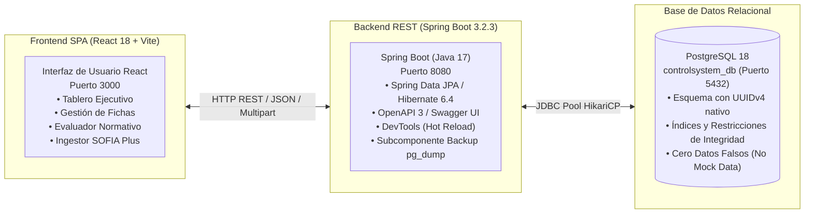

# Sistema de Control de Instructores — SENA CIES Huila

Plataforma integral web para la gestión pedagógica, control académico, seguimiento formativo y evaluación normativa de aprendices e instructores del **Servicio Nacional de Aprendizaje (SENA)** — Centro de la Industria, la Empresa y los Servicios (**CIES 9527**, Regional Huila).

---

## 1. Arquitectura del Sistema

El sistema implementa una arquitectura desacoplada de microservicio REST y Single Page Application (SPA):



### Tecnologías Principales
- **Front-end:** React 18, Vite 5, Phosphor Icons, SheetJS (`xlsx`), Lucide React.
- **Back-end:** Spring Boot 3.2.3, Java 17, Spring Web, Spring Data JPA, Hibernate 6.4, Spring Boot DevTools.
- **Documentación API:** SpringDoc OpenAPI 3.0 (`/swagger-ui.html`).
- **Base de Datos:** PostgreSQL 18 con identificadores nativos `UUIDv4` (`gen_random_uuid()`).
- **Seguridad e Identidad:** Arquitectura de IDs tipo UUID RFC 4122 para evitar ataques de enumeración IDOR.

---

## 2. Estructura del Repositorio

| Carpeta | Descripción |
|---|---|
| `back-end/` | Servidor Spring Boot 3.2.3 (Controladores, Servicios, Repositorios, Entidades JPA, DTOs). |
| `front-end/` | Aplicación cliente React 18 con Vite (Vistas, Componentes, Modales, Servicios de Red y Estado). |
| `DB/` | Esquema DDL oficial PostgreSQL (`DB/schema.sql`) con tipos UUID y restricciones relacionales. |
| `doc/hu/` | Historias de Usuario formales (HU-001 a HU-014) con diagramas Mermaid y criterios de aceptación. |
| `archivos/` | Reportes oficiales institucionales de prueba (ej: `Reporte de Juicios Evaluativos 3145556.xls`). |

---

## 3. Funcionalidades Principales

### 3.1. Gestión y Creación Normativa de Fichas (HU-007 y HU-012)
- Modal segmentado en **3 pasos normativos**:
  1. **Datos Básicos:** Número de ficha, tipo de formación (Titulada vs. Complementaria), jornada, fechas de ejecución, regional y centro.
  2. **Programa de Formación:** Selección estricta desde el catálogo institucional registrado (`PROGRAMAS_CATALOGO`) y fichas existentes. Los atributos curriculares (**Código de Programa**, **Versión**, **Nivel de Formación** y **Denominación Oficial**) se presentan en modo **Solo Lectura (`readOnly`)** con fondo contrastado y candados de seguridad para proteger la integridad de los datos.
  3. **Validación Curricular (Acuerdo 008 de 1997):**
     - **Formación Titulada:** Exigencia obligatoria de Diseño Curricular y Proyecto Formativo (GFPI-F-016).
     - **Formación Complementaria:** Exención formal de Proyecto Formativo conforme a los lineamientos del SENA.

### 3.2. Ingestor Oficial de Reportes Excel de SOFIA Plus / Zajuna (HU-008)
- Motor de procesamiento con deduplicación por número de documento:
  - En un archivo con 3.075 filas (41 aprendices $\times$ 75 RAPs), se registran exactamente **41 aprendices únicos** en la tabla maestra `aprendices`, y sus 75 juicios en `juicios_evaluativos_detalle`.
  - Normalización de marcas de tiempo no estándar (`16/12/2025 8.52 a` $\rightarrow$ `16/12/2025 08:52`) y seriales numéricos de Excel.
  - Regla de resolución de conflictos: El juicio `APROBADO` prevalece sobre reintentos o estados previos.
  - Trazabilidad y registro inmutable en `historial_cargues` con hash SHA-256.

### 3.3. Dashboard Ejecutivo y Tablero de Control Académico (HU-011)
- **KPIs Poblacionales:** Conteo diferenciado de aprendices **En Formación Activa** vs. **Excluidos de Cálculos** (Cancelados, Retiro Voluntario, Traslados).
- **Semáforo de Riesgo Académico:**
  - 🟢 **Verde:** $\ge 70\%$ de RAPs aprobados y 0 reprobados.
  - 🟡 **Amarillo:** Entre $40\%$ y $69\%$ de avance.
  - 🔴 **Rojo (Crítico):** $< 40\%$ de avance O presencia de juicios `NO APROBADO`.
- **Aprendices que Requieren Seguimiento Pedagógico:** Detección de casos prioritarios con botón directo de "Evaluar Caso" según el Reglamento del Aprendiz (Acuerdo 007 de 2012).
- **Avance por Fases del Proyecto Formativo:** Distribución porcentual en las 4 Fases oficiales (Análisis, Planeación, Ejecución, Evaluación).

### 3.4. Reorganización y Ordenamiento Interactivo en Todas las Tablas (HU-013)
- Soporte de ordenamiento multidireccional (ascendente `▲` / descendente `▼`) con un solo clic en cabeceras de columna a lo largo de las 7 tablas del sistema:
  1. Fichas de formación.
  2. Aprendices de la cohorte.
  3. Tabla de Aprendices en Riesgo y Seguimiento Pedagógico.
  4. Tabla de Auditoría y Citaciones a Comité.
  5. Detalle de los 75 RAPs individuales por aprendiz.
  6. Sesiones de Asistencia.
  7. Historial de Cargues de SOFIA Plus.

### 3.5. Sistema de Copias de Seguridad y Respaldo (HU-010)
- Generación de respaldos nativos PostgreSQL (`.sql`) mediante `pg_dump` y portátiles en formato JSON.
- Descarga directa de archivos de respaldo y restauración atómica en base de datos.
- Carpeta de almacenamiento local en servidor: `back-end/backups/`.

### 3.6. Evaluador Normativo y Citaciones a Comité (HU-005 y HU-006)
- Tipificación de faltas según el Reglamento del Aprendiz (Leve, Grave, Gravísima).
- Criterios de mérito para citación a Comité de Evaluación y Seguimiento.
- Generación de acta de citación formal con artículos normativos invocados.

---

## 4. Documentación de la API REST (OpenAPI 3 / Swagger)

La documentación interactiva se encuentra disponible en tiempo real en:
- **Swagger UI:** `http://localhost:8080/swagger-ui.html`
- **OpenAPI JSON:** `http://localhost:8080/v3/api-docs`

### Matriz de Endpoints Principales

| Módulo | Método | Endpoint | Descripción | Identificador |
|---|---|---|---|---|
| **Salud** | `GET` | `/api/health` | Estado del backend y conexión PostgreSQL | N/A |
| **Fichas** | `GET` | `/api/fichas` | Listar todas las fichas | Listado |
| **Fichas** | `GET` | `/api/fichas/{id}` | Consultar detalle de ficha (por UUID o número) | UUID / String |
| **Fichas** | `POST` | `/api/fichas` | Registrar nueva ficha | UUID generado |
| **Fichas** | `PUT` | `/api/fichas/{id}` | Actualizar datos y proyecto formativo | UUID |
| **Fichas** | `DELETE`| `/api/fichas/{id}` | Eliminar ficha en cascada | UUID |
| **Juicios** | `POST` | `/api/fichas/{fichaId}/juicios/upload` | Procesar archivo Excel SOFIA Plus | UUID Ficha |
| **Juicios** | `GET` | `/api/fichas/{fichaId}/juicios/aprendices` | Consultar aprendices únicos y métricas | UUID Ficha |
| **Juicios** | `GET` | `/api/fichas/{fichaId}/juicios/historial` | Historial de archivos cargados | UUID Ficha |
| **Reglamento**| `POST` | `/api/reglamento/evaluar` | Evaluar falta disciplinaria o académica | UUID Aprendiz |
| **Reglamento**| `GET` | `/api/reglamento/ficha/{fichaId}` | Consultar citaciones a comité | UUID Ficha |
| **Backups** | `POST` | `/api/backup/create` | Crear copia de seguridad nativa `.sql` | Servidor |
| **Backups** | `GET` | `/api/backup/list` | Listar respaldos existentes | Listado |
| **Backups** | `GET` | `/api/backup/download/{filename}` | Descargar archivo de respaldo | Archivo |
| **Backups** | `POST` | `/api/backup/restore/{filename}` | Restaurar base de datos | Archivo |

---

## 5. Instalación y Puesta en Marcha

### Prerrequisitos
- **Java:** OpenJDK 17 o superior.
- **Node.js:** v18.0 o superior con `npm`.
- **Base de Datos:** PostgreSQL 14+ (probado y optimizado en PostgreSQL 18).
- **Maven:** 3.8+ (o wrapper `mvnw`).

### 5.1. Configuración de Base de Datos
1. Iniciar el servicio de PostgreSQL y crear la base de datos:
   ```sql
   CREATE DATABASE controlsystem_db;
   ```
2. Ejecutar el esquema oficial:
   ```bash
   psql -U postgres -d controlsystem_db -f DB/schema.sql
   ```

### 5.2. Ejecución del Backend (Spring Boot)
1. Ubicarse en la carpeta `back-end`:
   ```bash
   cd back-end
   ```
2. Compilar el proyecto:
   ```bash
   mvn clean package -DskipTests
   ```
3. Ejecutar el servidor:
   ```bash
   java -jar target/controlsystem-backend-1.0.0.jar
   ```
   *El servidor quedará escuchando en `http://localhost:8080`.*

### 5.3. Ejecución del Frontend (React + Vite)
1. Ubicarse en la carpeta `front-end`:
   ```bash
   cd front-end
   ```
2. Instalar dependencias:
   ```bash
   npm install
   ```
3. Iniciar el entorno de desarrollo:
   ```bash
   npm run dev
   ```
   *La aplicación estará accesible en `http://localhost:3000`.*

---

## 6. Verificación de Calidad y Tests de Ingesta

El sistema cuenta con scripts automatizados de verificación de ingesta y fidelidad de datos con reportes oficiales reales:

```bash
# Ejecutar test de cargue contra backend y base de datos PostgreSQL
node scratch/run_full_cargue_test.js
```

### Resultados de Verificación Oficial (Ficha 3145556 - ADSO)
- **Filas en Reporte Excel:** 3.075 filas procesadas.
- **Aprendices Únicos:** 41 aprendices registrados.
- **Total de Juicios:** 3.075 juicios (75 RAPs exactos por aprendiz).
- **Aprobados Totales:** 2.141 juicios.
- **Pendientes Totales:** 930 juicios.
- **No Aprobados Totales:** 4 juicios (asignados a `JUAN DAVID CABRERA CABALLERO`, C.C. 1080183250).
- **Aprendices Activos que Requieren Seguimiento Pedagógico (Semáforo Crítico):**
  1. `DIEGO FELIPE RAMIREZ SILVESTRE` (C.C. 1077229318) — $17.3\%$ de avance, 0 reprobados.
  2. `JUAN DAVID CABRERA CABALLERO` (C.C. 1080183250) — $69.3\%$ de avance, 4 reprobados.
- **Datos Simulados / Mocks:** 0 registros mock (purgados y validados al 100%).

---

## 7. Historias de Usuario Documentadas

En la carpeta [`doc/hu/`](file:///doc/hu/) se encuentran especificadas las historias de usuario del proyecto:

- [HU-001: Registro de Trabajos y Actividades](file:///doc/hu/HU-001-registro-trabajos.md)
- [HU-002: Gestión y Custodia de Evidencias](file:///doc/hu/HU-002-gestion-evidencias.md)
- [HU-003: Llamado y Registro de Asistencia](file:///doc/hu/HU-003-llamado-asistencia.md)
- [HU-004: Control Académico y Seguimiento SENA](file:///doc/hu/HU-004-control-academico-sena.md)
- [HU-005: Evaluador Normativo con Reglamento del Aprendiz (Acuerdo 007 de 2012)](file:///doc/hu/HU-005-reglamento-aprendiz.md)
- [HU-006: Asistente Virtual IA para el Reglamento](file:///doc/hu/HU-006-asistente-ia-reglamento.md)
- [HU-007: Gestión y Consulta de Fichas de Formación](file:///doc/hu/HU-007-gestion-fichas.md)
- [HU-008: Sección y Carga de Reportes de Juicios Evaluativos SOFIA Plus](file:///doc/hu/HU-008-reportes-juicios-evaluativos.md)
- [HU-009: Reporte de Proyecto Formativo (GFPI-F-016)](file:///doc/hu/HU-009-reporte-proyecto-formativo.md)
- [HU-010: Copias de Seguridad, Respaldo y Restauración de Base de Datos](file:///doc/hu/HU-010-copias-seguridad-respaldo-restauracion.md)
- [HU-011: Dashboard Ejecutivo y Tablero de Control de Progreso por Ficha](file:///doc/hu/HU-011-dashboard-ejecutivo-progreso-ficha.md)
- [HU-012: Segmentación Normativa para Creación de Fichas y Validación Curricular](file:///doc/hu/HU-012-segmentacion-ficha-normativa-curricular.md)
- [HU-013: Reorganización y Ordenamiento Interactivo por Columnas en Todas las Tablas](file:///doc/hu/HU-013-ordenamiento-columnas-tablas-sistema.md)
- [HU-014: Arquitectura Backend Spring Boot 3.2, Persistencia PostgreSQL 18 con Identificadores UUIDv4 y Documentación OpenAPI/Swagger](file:///doc/hu/HU-014-arquitectura-backend-uuid-swagger.md)

---

## 8. Autor y Créditos

- **Instructor Responsable:** Carlos Julio Cadena Sarasty
- **Centro de Formación:** Centro de la Industria, la Empresa y los Servicios (CIES 9527)
- **Regional:** Regional Huila — Servicio Nacional de Aprendizaje (SENA)
- **Contacto:** cjsarasty@gmail.com
